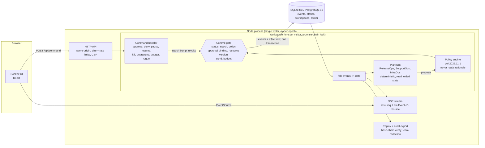

# Architecture

WATCHSHIFT is one Node 24 process (native TypeScript, one runtime dependency: `pg`) serving a React cockpit and a
JSON + Server-Sent Events API. Decisions and the alternatives considered are in
[ARCHITECTURE-DECISIONS.md](ARCHITECTURE-DECISIONS.md).



## Event-sourced core (`src/engine.ts`)

State is `fold(events)`. Nothing mutates state except the fold, and nothing appends events except
`Workspace.emit`, which writes atomically through the store:

- **Owner-epoch fence.** Each process claims the database (`owner` row, epoch + 1). Every append re-reads the owner
  epoch inside the transaction; a process that lost ownership gets `FencedError` and the server refuses writes (503).
- **Optimistic head check.** An append carries the expected previous hash; a mismatch is a `ConflictError`.
- **Effects table.** Every committed effect has a row with `UNIQUE (ws, op_id)`; `opId = agent:proposal.key`, so a
  retried or duplicated commit cannot apply twice.
- **Hash chain.** `hash = sha256(prevHash + canonical({seq, ts, type, agent, task, step, actor, corr, policyVersion, data}))`,
  genesis `0 x 64`. `Workspace.load` re-verifies the chain and refuses a tampered workspace.

### Agent step

```
StepPlanned -> ActionProposed -> PolicyEvaluated
   allow   -> ActionDispatched -> (simulated latency) -> commit gate -> ActionCompleted + effect | EffectAborted
   approve -> ApprovalRequested -> ApprovalGranted | Denied | Expired | Revoked -> dispatch as above
   block   -> ActionRejected (+ DriftDetected, RogueBehaviorDetected, AgentQuarantined when it is rogue)
```

Agent status: `RUNNING, WAITING_APPROVAL, PAUSED, BLOCKED, QUARANTINED, KILLED, COMPLETED` (the directive's `IDLE`
and `FAILED` are not reachable in this demo: agents start running and a failed step becomes an event, not a state).

### Commit gate (`Workspace.gate`)

Checked at dispatch **and again at the commit point** under the workspace lock:

1. agent status is `RUNNING` and the agent epoch equals the epoch the action was minted under;
2. policy re-evaluated now (not trusted from the proposal time) is not `block`;
3. if approval was needed: the approval is granted (dispatch) or consumed by this op (commit) and its binding hash
   equals the hash of the action actually being dispatched;
4. the target resource version is unchanged since the approval;
5. the op id has not committed before; the task budget is not exhausted.

Pause, quarantine, kill and crash recovery bump the epoch and revoke pending approvals. Kill is terminal. Resume
re-plans from current state; nothing approved before the pause survives it.

### Approvals

The binding is `{workspace, agent, task, step, tool, params, policyVersion, epoch, resourceVersion}`, hashed
canonically. Approvals are single use, expire after 10 minutes, and are authorised by team.

### Policy (`src/policy.ts`)

Checks: schema, capability, goal scope, data egress, refund rules (original payment method, refundable balance,
auto limit $50), release checks, capacity change > 50%, budget. Verdict is the strictest check. The engine never
reads the agent's rationale, so persuasive text cannot change a verdict.

### Drift and rogue detection

Drift signals with causal reasons: capability (tool never granted), goal (tool does not serve the task), egress
(data leaving the boundary), repeated rejections, spend. A write outside capability or a blocked egress is
**rogue**: the action is blocked before any effect, `RogueBehaviorDetected` is emitted with a counterfactual
computed by `unguardedExecute` on a `structuredClone` of the world (the negative control), and the agent is
auto-quarantined.

## Replay and audit (`src/audit.ts`)

`replay(S, agent, n)` groups persisted events by step and re-folds the log up to each step to show the state after
it, plus operator interventions. Only recorded events are shown: there is no hidden chain-of-thought to reveal; the
"rationale" is the agent's structured proposal (summary, evidence, expected outcome).

`exportAudit(S, role)` exports the whole chain. Events of teams the role does not belong to are redacted to
`{seq, prevHash, hash}`, so the chain still verifies offline (`npm run verify-audit -- file.json`) without leaking
another team's content. CSV export neutralises spreadsheet formulas.

## Read model and transport

`view(S)` builds the UI read model (agents, approvals, incidents, cost series, world summary). The SSE stream sends
each event with `id: seq`, resumes after `Last-Event-ID`, throttles snapshots to 200 ms and pings every 15 s; the
client de-duplicates by seq.

## Storage

`SqliteStore` (`node:sqlite`) locally and in tests; `PgStore` (PostgreSQL 16) when `DATABASE_URL` is set. Both
implement the same `Store` interface and the whole test suite runs against both (CI does both).
Workspaces older than 6 h are pruned; idle workspaces leave memory after 15 min and reload from the database.

## Limits stated plainly

Single writer per database; no real model calls (planners are deterministic, tokens are simulated); no real
authentication (the operator role is a demo switch, still enforced server-side); no real external systems.
